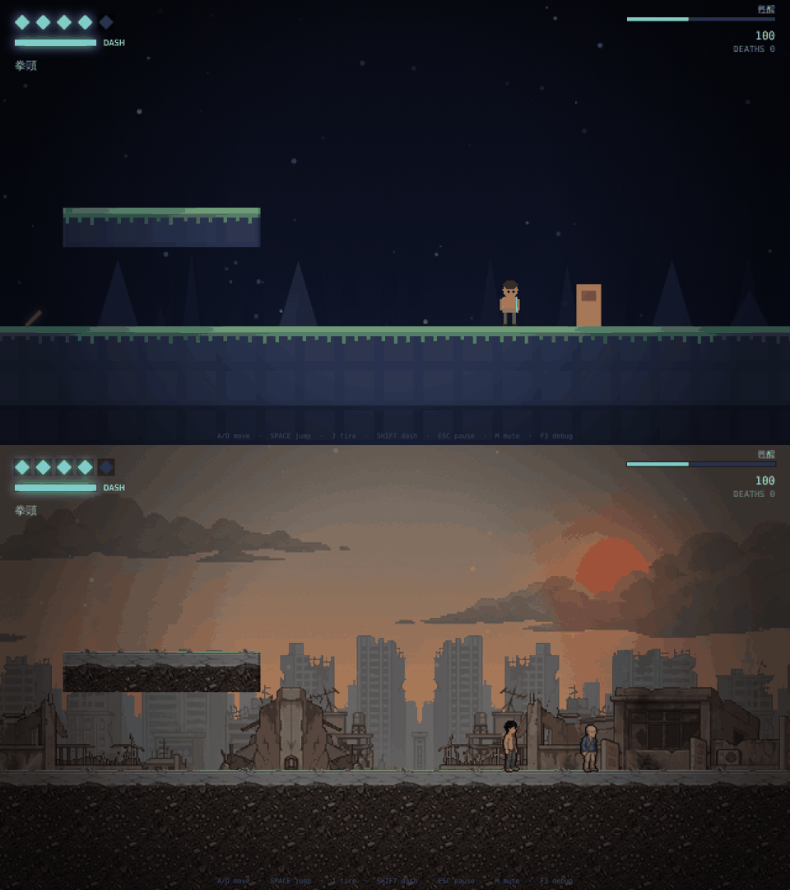

# Hollow Runner

一款 2D 橫向捲軸動作射擊遊戲，以《空洞騎士》(Hollow Knight) 的操作手感為參照：
流暢的角色控制、可變高度跳躍、衝刺、爬牆跳，以及會捲動的大地圖場景。
在這之上，另外搭建了一套完整的劇情系統——場景堆疊、對話、過場動畫、能力解鎖與存檔，
以及一套資料驅動的武器系統——近戰揮砍與槍械瞄準／彈著擴散，
並用它們做出了第一章劇情關卡「焦土台灣：甦醒」。

使用純 HTML5 Canvas + 原生 ES Modules 開發，**執行時零相依套件**、不需要建置步驟。
美術預設使用以 Gemini 生成、再經自動後製流程處理的圖檔（已隨 repo 附帶，執行時
不連任何外部服務）；網址加 `?art=classic` 可切回原本純程式繪製的版本。音效以
WebAudio 即時合成。

## 快速開始

**線上試玩：<https://czpeanut.github.io/GAME/shooter/>**

```bash
npm start          # 啟動本機伺服器，開啟 http://localhost:8080
```

> ES Modules 無法從 `file://` 直接載入（瀏覽器 CORS 限制），所以需要透過
> `npm start` 提供的簡易靜態伺服器來執行，它本身也沒有任何相依套件。

預設開啟的是劇情第一章「焦土台灣：甦醒」——主角一開始只能空手，武器（棍棒、
刀具、後期的手槍）要在關卡裡實際撿到才能使用，衝刺則隨劇情進展解鎖
（見下方「劇情系統」與「武器系統」）。原本的純動作關卡「The Undercroft」
仍完整保留在 `src/game/level.js` 的 `buildLevel1()`，可作為獨立關卡使用。

## 操作方式

| 動作 | 鍵盤 | 手把 |
| --- | --- | --- |
| 移動 | `A` `D` / 方向鍵 | 左類比 / 十字鍵 |
| 跳躍 | `Space` / `K` | A |
| 攻擊／開火 | 滑鼠左鍵 / `J` / `Z` | X / RT |
| 槍械瞄準 | 滑鼠右鍵（按住）/ `U` | LT |
| 衝刺 | `Shift` / `L` | B / RB |
| 對話／互動 | `E` | Y |
| 暫停 | `Esc` / `P` | Start |
| 靜音 | `M` | — |
| 除錯資訊 | `F3` | — |

- **可變跳躍高度**：按住跳得高，輕點跳得低。
- **攻擊行為依武器而定**：手上是近戰武器（拳頭/棍棒/刀具）時，左鍵是一次
  有冷卻時間的揮砍；手上是槍械時，**右鍵按住瞄準、左鍵扣扳機**（半自動，
  一按一發，見「武器系統」）。
- **瞄準方向**：用滑鼠時槍口直接指向游標；用鍵盤/手把時，按住 `W`/`S`
  （上/下）改變方向，含八方向斜射。
- **踩踏**：從高處落下踩到敵人可造成傷害並彈起。
- **觸控裝置**：在手機／平板上開啟時會自動偵測觸控並顯示畫面上的虛擬按鍵
  （左下十字方向鍵、右下攻擊/跳躍/衝刺/互動鍵、右上暫停），滑鼠與鍵盤
  裝置完全看不到、也不受影響。細節見下方「觸控操作」。
- **衝刺**：八方向，帶無敵幀；落地或觸牆後恢復。
- **對話中**：`W`/`S` 切換選項，`J`/`Space` 確認（文字未跑完時先跳過打字機效果）。

## 觸控操作

`src/engine/touch-controls.js` 在偵測到粗指標裝置（`matchMedia('(pointer: coarse)')`
或 `'ontouchstart' in window`）時，自動顯示 `index.html` 裡 `#touch-controls`
的畫面按鍵——左下十字方向鍵（含上/下，對應瞄準方向與對話選項切換）、
右下五顆動作鍵（瞄準/互動/衝刺/攻擊/跳躍），右上一顆暫停鍵。滑鼠與鍵盤裝置
永遠看不到這層 UI，也不會載入任何監聽器。

按鍵透過 `Input.touchDown(action)` / `touchUp(action)` 餵給與鍵盤、手把
完全相同的 action 名稱（`left`/`fire`/`dash`...），下游的 `Player`、
`DialogueScene` 等完全不知道輸入是從哪裡來的。每顆按鍵各自追蹤自己的
pointer 狀態，用 `pointercapture` 確保手指滑出按鍵範圍再放開時，
放開事件仍然會送達，不會卡在「一直按著」的狀態。

### 觸控適配的取捨

- 按鍵位置固定在畫面左右下角並考慮 `env(safe-area-inset-*)`，避開瀏海/
  手勢列。
- 按下時 `pointerdown` 立即呼叫 `touchDown()`，不像 `mouseup`/`click`
  那樣要等放開才觸發——攻擊鍵持續按住才有意義（近戰揮砍冷卻、槍械瞄準）。
- 這套系統假設橫向持機遊玩（與大部分側捲軸動作遊戲相同），直向模式下
  按鍵仍然可用，只是可視空間較侷促。

## 手感設計（Game Feel）

動作遊戲的「手感」多半來自玩家察覺不到的容錯設計。本專案實作了：

| 機制 | 說明 | 位置 |
| --- | --- | --- |
| Coyote time | 走出平台邊緣後 0.1 秒內仍可跳躍 | `player.js` |
| Jump buffering | 落地前 0.12 秒按下的跳躍，會在著地瞬間觸發 | `player.js` |
| 可變跳躍高度 | 放開跳躍鍵立即截斷上升速度至 42% | `player.js` |
| 非對稱重力 | 下落比上升更快，頂點附近重力減弱以產生滯空感 | `constants.js` |
| 轉向加速 | 反向輸入時加速度加倍，讓轉身更俐落 | `player.js` |
| 命中停頓 (hit-stop) | 命中/受擊時凍結數幀，讓打擊有重量 | `game.js` |
| 畫面震動 | 以 trauma² 衰減，大擊有感、小擊不吵 | `camera.js` |
| 擠壓拉伸 | 起跳與落地時的形變回饋，依落地速度縮放 | `player.js` |
| 攝影機死區 | 小幅移動不推動鏡頭，避免畫面晃動 | `camera.js` |
| 速度預看 | 鏡頭朝行進方向偏移，讓玩家看見前方 | `camera.js` |

所有數值集中在 `src/game/constants.js`，可單獨調整而不必翻找程式碼。

## 劇情系統

在動作遊戲的手感之上，另外搭了一層完全獨立的劇情系統，讓「加入對話與故事」
不必重寫任何物理或戰鬥程式碼。

### 場景堆疊（Scene Stack）

`Game` 不再用一個扁平的字串（`'playing' | 'paused' | ...`）記狀態，而是用一疊
`Scene`（`src/engine/scene.js`）：世界（`WorldScene`）永遠墊在最底層、不會被
彈出，暫停、死亡、對話、過場動畫都是疊上去的畫面。這代表：

- 對話框可以疊在遊戲畫面「上面」而不是「取代」它——角色與場景在對話框後面
  依然看得到、依然有微幅的環境動畫（粒子、視差背景）。
- 新增一種畫面（例如商店、地圖）不需要更動既有的任何狀態分支，只要再寫一個
  `Scene` 子類別疊上去即可。
- `game.state` 仍然存在（從堆疊頂端推導），舊有讀取它的地方不必更動。

`WorldScene` 用三個旗標決定自己該跑多少：`frozen`（完全靜止，只有暫停選單會用）、
`simulate`（關掉時角色/敵人/子彈停止模擬，但粒子、背景、鏡頭仍在動，讓畫面
不會像被按了暫停鍵）、`showHud`（是否顯示血條等常駐介面，只有標題畫面關閉它）。
這三個旗標由疊在上面的場景自己在 `enter()`/`exit()` 時切換，`WorldScene`
完全不需要知道上面疊的是哪一種畫面。

### 劇情狀態與能力解鎖

`StoryState`（`src/game/story-state.js`）記錄旗標（flag）、已解鎖的能力、
存檔點，並可存讀 `localStorage`（沒有 storage 的環境——純 Node 測試、
鎖死的 webview——會安全地退化成不存檔，不會拋錯）。

角色的衝刺、二段跳、爬牆跳都改成讀取 `player.abilities`，預設
（沒有接上 `game.story` 時，例如所有既有測試）**全部開啟**，行為與加入
劇情系統前完全一致。要做出「這個能力要在劇情裡才解鎖」的效果，是關卡自己
選擇的事：

```js
new StoryState({ dash: false })   // 讓衝刺一開始鎖住
story.grantAbility('dash')        // 在對話或過場動畫裡解鎖
```

能力讀取是即時的（不是建構時複製一份），所以過場動畫一解鎖，下一幀角色
就能衝刺，不必等重生或重新載入關卡。

`abilities` 裡**沒有** `fire` 這一項——能不能開火，是「手上有沒有武器」
決定的，不是能力旗標，見下方「武器系統」。

### 觸發器與 NPC

`StoryTrigger`（`src/game/trigger.js`）是一個看不見的矩形，玩家走進去就會
呼叫一個回呼函式——可以開對話、設旗標、解鎖能力。`once: true`（預設）代表
只觸發一次；也可以額外指定 `flag`，讓它記在 `StoryState` 裡，即使整個關卡
重新讀取也不會再觸發第二次。`Npc` 則是站著不動、玩家靠近按 `E` 才觸發互動的
角色，本身不知道對話系統存在，純粹是資料 + 回呼。

在 `LevelBuilder` 上對應的 API：

```js
b.storyTrigger(c0, r0, c1, r1, { flag: 'found_note', onEnter: (world, game) => {...} });
b.npc(col, row, { id: 'old-zhou', onInteract: (world, game) => {...} });
```

### 對話（Dialogue）

對話是一個節點圖（`DialogueRunner`，`src/game/dialogue-runner.js`），每個節點
可以有多行文字（逐行打字機效果顯示）、`next` 接到下一個節點、或是 `choices`
分支成多個選項，每個選項各自可以設旗標、解鎖能力、接到不同節點。這一整套
邏輯完全不碰 canvas 或 DOM，可以直接在 Node 裡測試分支是否正確、旗標是否
真的被設到、打字機計時對不對。

實際畫面渲染在 `DialogueScene`（`src/game/scenes/dialogue-scene.js`），文字
自動換行用 `wrapText`（`src/engine/text.js`）：中文沒有空白可以斷行，
所以是逐字判斷寬度來斷行，並且處理了基本的「行首禁則」（不能用「」』，。」
開頭）與「行尾禁則」（不能用「『」結尾）。

### 過場動畫（Cutscene）

`CutsceneRunner`（`src/game/cutscene-runner.js`）依序執行一串步驟：
`wait`（等待）、`fadeIn`/`fadeOut`（畫面淡入淡出）、`dialogue`（開一段對話，
對話關閉後才繼續）、`setFlag` / `grantAbility`（立即生效）、`call`（任意
回呼）。過場動畫期間 `world.simulate = false`，玩家完全無法操作，直到過場
結束。

## 武器系統

戰鬥能力不是能力旗標，而是「手上實際拿著什麼」——武器是關卡裡可撿拾的
實體物件（`WeaponPickup`，`src/game/pickup.js`），撿到後 `player.weaponId`
立刻切換，下一次按攻擊鍵就用新武器的規格，不需要重生或重新載入關卡。

### 武器資料表

所有武器定義集中在 `src/game/weapons.js` 的 `WEAPONS`，每種武器只是一組數值，
新增武器不必碰 `player.js` 的邏輯：

```js
export const WEAPONS = {
  fists:  { type: 'melee',  damage: 1, range: 14, cooldown: 0.24, knockback: 70  },
  stick:  { type: 'melee',  damage: 1, range: 24, cooldown: 0.32, knockback: 160 },
  knife:  { type: 'melee',  damage: 2, range: 17, cooldown: 0.26, knockback: 90  },
  pistol: { type: 'ranged', damage: 4, knockback: 320, range: 560, fireRate: 0.28,
            aimRampTime: 2.4, spreadMax: 0.5, spreadMin: 0.025, bloom: 0.3,
            moveSpread: 0.14, kick: 7, trauma: 0.34, recoil: 150 },
};
```

角色一律從 `fists`（空手）開始——空手也能打，但傷害低、擊退弱，純粹是
「沒有武器時不至於完全無法自衛」的保底，不是要玩家依賴的選項。

### 近戰：即時判定，不是拋射物

近戰攻擊按下的瞬間，直接在角色面前開一個矩形範圍（`meleeAttack`，
`src/game/scenes/world-scene.js`），對範圍內**所有**重疊的敵人同時造成傷害，
不會產生子彈物件。每種近戰武器有自己的攻速上限（`cooldown`）——按住攻擊鍵
不會比武器本身的節奏更快，棍棒揮得比拳頭慢但打得更遠、擊退更強。

### 槍械：瞄準會抖，穩住才準

手槍不是按下就打死打準——這是刻意還原一個不熟練的人用槍的手感。瞄準和扣扳機
是兩個分開的動作：

- **扇形**：每一發的方向，都是從槍口前方一個半角為 `player.spread` 的扇形裡
  均勻隨機取一個角度。畫面上畫出來的扇形就是真正的判定範圍，不是裝飾。
- **右鍵瞄準**：按住時扇形從 `spreadMax`（腰射，很亂）線性收窄到 `spreadMin`
  （完全穩定），需要 `aimRampTime`（手槍 2.4 秒）。顏色由橘轉綠，HUD 也有
  穩定度量表。放開右鍵扇形會以三倍速度張開；移動或跳躍中扇形收不到最窄。
- **左鍵射擊**：半自動，一按一發。每一發都讓扇形擴張 `bloom`——後座力把準心
  甩開，要再穩一下下一發才會準；連續亂扣只會越打越散。
- **瞬間命中、一道火光**：子彈不是會飛的物件，而是 hitscan——扣下的瞬間沿
  射線找出第一個擋到的牆或敵人（最遠 `range`），畫一道約 0.1 秒的火光彈道
  （橘色光暈＋白熱核心，用加色混合疊亮）。打到敵人會有短暫的 hit-stop 與噴濺，
  打到牆會濺出火花和水泥粉塵。
- **後座力與畫面反應**：每一發整個畫面會往槍口反方向「頓」一下（`camera.kick`，
  方向性位移、快速彈回），加上隨機震動（`trauma`），人物被往後推，槍枝往
  肩膀方向縮並槍口上揚，然後才回位——比任何近戰攻擊都重得多。
- 傷害、擊退都大幅高於近戰武器（見上表），搭配更沉的槍聲（尖銳爆裂聲＋
  低頻重擊＋廢墟回音，`src/engine/audio.js` 的 `shoot()`）。

### 在關卡裡放武器

```js
b.weaponPickup(col, row, 'stick');   // 在關卡座標放一把可撿的棍棒
```

### 甦醒：第一章

`src/game/levels/opening.js` 是用以上所有系統組出來的實際內容：

醒來（過場動畫）→ 環境敘事（牆上的公告）→ 純跳躍教學缺口 → 撿到一根棍棒
→ 第一名持刀劫匪（近戰教學）→ 與倖存者老周對話（五年前的戰爭、政府瓦解、
解放軍殘部與劫匪、尋找家人的線索，含一個分支選項）→ 獲得手槍 → 第二名
劫匪（示範槍械威力大幅超越棍棒）→ 找到腎上腺素（解鎖衝刺）→ 衝刺缺口
→ 廢棄哨戒砲台 → 章節結尾過場動畫與收尾畫面。

雙跳與爬牆跳兩項能力在本章維持解鎖狀態——這一章的地形沒有用到它們，
沒有劇情理由的限制就不刻意加上去。

## 專案結構

```
index.html            版面與 canvas 容器
serve.js              零相依靜態伺服器（開發用）
assets/
  player.png          程式繪製版角色 sprite sheet（?art=classic）
  ai/                 Gemini 生成美術處理後的成品（預設）
    src/              生成原圖（1/3 縮圖存檔，可重跑後製）
tools/
  png.mjs             自製 PNG 編碼器與像素畫布（僅用 node:zlib）
  make-spritesheet.mjs 產生 assets/player.png
  gemini_gen.py       Gemini 生圖用戶端（金鑰從 GEMINI_API_KEY 讀取）
  ai_spritesheet.py   動畫條 → sprite sheet：去背、切格、校準比例、對齊、描邊
  ai_backdrop.py      背景層與地面材質：去背、霧化、無縫化
  ai_art/             各 sprite sheet 的打包設定
docs/                 文件用圖
src/
  main.js             進入點：畫布縮放、事件綁定、啟動迴圈、選擇要載入的關卡
  engine/             與遊戲內容無關的通用層
    loop.js           固定時間步長主迴圈（物理與畫面更新分離）
    input.js          鍵盤 + 手把 + 觸控輸入，含按鍵邊緣偵測
    touch-controls.js 畫面觸控按鍵：偵測觸控裝置、綁定 pointer 事件到 input.js
    camera.js         死區、預看、邊界夾制、震動
    particles.js      物件池粒子系統（避免 GC 卡頓）
    audio.js          WebAudio 即時合成音效
    sprites.js        Sprite sheet 載入與單格繪製
    animator.js       動畫幀計時（不依賴 DOM）
    tilemap.js        圖磚網格與碰撞查詢
    math.js           數學工具
    scene.js          場景堆疊：Scene 基底類別與 SceneStack
    text.js           中文友善的文字換行（純函式，不依賴 canvas）
  game/
    constants.js      所有手感與數值調校參數
    body.js           AABB 移動體與圖磚碰撞解析
    player.js         玩家控制器（含能力閘門、武器攻擊/瞄準）
    player-anims.js   Sprite 版面定義與動畫狀態選擇（純函式）
    enemy.js          敵人：Walker（持刀劫匪）/ Flyer / Turret
    weapons.js        武器資料表（近戰/槍械數值）
    pickup.js         可撿拾的武器物件（WeaponPickup）
    bullet.js         彈丸
    level.js          LevelBuilder 關卡建構 API 與第一關（The Undercroft）
    levels/
      opening.js       第一章「甦醒」的關卡幾何、觸發器、能力解鎖流程
    dialogues/
      opening-dialogues.js  第一章的對話文本
    story-state.js    劇情旗標、能力解鎖、存讀檔
    trigger.js        StoryTrigger（劇情觸發區）與 Npc
    dialogue-runner.js  對話節點圖狀態機（純函式，可離線測試）
    cutscene-runner.js  過場動畫步驟執行器（純函式，可離線測試）
    scenes/
      world-scene.js    遊戲世界本體（原本 game.js 的主要內容）
      title-scene.js    標題畫面
      pause-scene.js    暫停選單
      death-scene.js    death 畫面
      win-scene.js      戰鬥關卡的通關畫面（分數/死亡數/時間）
      ending-scene.js   劇情關卡的收尾畫面（不用分數/時間，純文字）
      dialogue-scene.js 對話框渲染與輸入處理
      cutscene-scene.js 過場動畫的場景包裝（含淡入淡出、巢狀對話）
    background.js     多層視差背景
    tilerender.js     圖磚繪製（含視野裁切）
    hud.js            常駐介面（血條/衝刺量表/分數）+ 疊層畫面共用的繪圖函式
    game.js           頂層容器：canvas/input/audio/story，轉發至 WorldScene
    art.js            美術組切換（ai / classic）與所有 AI 素材的載入定義
test/                 測試
```

### 幾個設計取捨

- **固定時間步長**：物理以 1/60 秒固定推進，畫面則每個 animation frame 繪製一次。
  跳躍弧線與衝刺距離因此在任何更新率的機器上都完全一致。
- **分軸碰撞解析**：先解 X 再解 Y。同時處理兩軸會讓「撞到牆」與「踩到地」
  難以區分，也會讓角色卡在由多塊平坦圖磚拼成的地面接縫上。
- **子步進**：高速移動（衝刺、長距墜落、子彈）會拆成不超過半格的子步驟，
  確保不會穿透牆面。
- **粒子物件池**：粒子從固定大小的池中重複使用，激烈戰鬥時不會觸發 GC 停頓。
- **視野裁切**：地圖有 4350 格圖磚，每幀只繪製鏡頭範圍內的部分。

## AI 生成美術（Gemini）



主角、持刀劫匪、老周、三層視差背景（夕陽天空與台北 101 剪影／遠景廢墟大樓／
近景騎樓街屋）與地面材質，都是用 Gemini 影像模型（`gemini-3-pro-image`）生成，
再經過下面這套**全自動**後製流程變成遊戲可用的素材。

### 流程

1. **生成**（`tools/gemini_gen.py`）：每個動作生成一張「一排 N 個姿勢、純洋紅
   背景」的動畫條。第一張成功的角色圖會當作**參考圖**附在之後每一次請求裡，
   這是讓不同動作之間角色長相一致的關鍵。
2. **校準人物**：模型會把畫面撐滿，蹲姿、躍起、衝刺的人物會被畫得比站姿大。
   所以每條動畫的**第一個人物固定是標準站姿**，後製用它的高度算出該張圖的比例，
   然後丟掉。少了這一步，主角的頭在不同動作間會忽大忽小。
3. **切格**（`tools/ai_spritesheet.py`）：去背（含邊緣去洋紅溢色）→ 依空白欄位
   切出每個人物；人物重疊時（例如伸出去的刀越過下一個人物的背）改用連通區域
   切割 → 以同一比例縮到約 40px 高 → 以質心水平置中、腳底對齊 → 加 1px 暗色
   描邊（不描邊的話，穿棕色衣服的人物會融進棕色廢墟背景裡）→ 依 `ANIMS` 版面打包。
4. **背景與材質**（`tools/ai_backdrop.py`）：去背、以天空顏色做景深霧化、
   左右無縫化；地面材質做四方向無縫處理。

重跑後製（不需金鑰、不會呼叫 API）：

```bash
python3 tools/ai_spritesheet.py tools/ai_art/player.json   # 也有 walker.json / zhou.json
python3 tools/ai_backdrop.py assets/ai/src assets/ai
```

重新生成原圖需要自己的金鑰，**金鑰只從環境變數讀取，不寫進任何檔案**：

```bash
GEMINI_API_KEY=... python3 tools/gemini_gen.py out.png "提示詞" --ref 參考圖.png --aspect 21:9 --size 2K
```

### 評估：做得到，但有明確的邊界

| 項目 | 結果 |
| --- | --- |
| 角色一致性（同一角色跨多張圖） | **很好**。附參考圖後，臉、髮型、服裝、口袋位置在 7 組動作間都對得上 |
| 比例一致性 | 模型本身做不到；靠「校準人物」技巧解決 |
| 動作正確性 | **普通**。跑步循環第一次生成時腿沒有正確交替，要在提示詞裡逐格描述才堪用；不是專業動畫師水準 |
| 指令衝突 | 會出錯：要求劫匪「張嘴吼叫」時，面罩直接消失；改提示詞後修正 |
| 輸出格式 | 常不照做：會自己加白色格子、在背景層留白，後製要能容錯 |
| 縮到遊戲尺寸 | 原圖人物約 1200px 高，縮到 40px 會損失細節（頭髮變色塊），描邊能補回辨識度 |
| 背景與材質 | **非常好**，在地元素（騎樓、鐵窗、直式招牌、藍白拖）一次到位 |
| 成本與時間 | 本次共生成約 22 張 2K 圖，每張約 20 秒（可平行）；費用依 Google 當時的計價，大約幾美元等級 |

結論：**以「一個人 + AI」的規模做出完整、風格統一的遊戲美術是可行的**，背景與
角色設計品質甚至高於手工程式繪製；真正的瓶頸在動畫——AI 給的是「一張張好看的
姿勢」，不是連貫的動作，幀數少（2–6 格）還可以接受，要做到《空洞騎士》等級的
流暢動畫，仍需要人工逐格修整或改用其他方法（例如 Veo 影片生成後抽格）。

尚未用 AI 美術取代的部分：飛行敵人、砲台、武器拾取圖示、尖刺與單向平台，仍是
程式繪製。

## 角色美術（Sprite Sheet）

角色使用 sprite sheet 繪製，圖檔在 `assets/player.png`。

**版面**：6 欄 × 7 列，每格 32 × 40 px（192 × 280 px）。列的順序**必須**與
`src/game/player-anims.js` 的 `ANIMS` 一致：

| 列 | 動畫 | 幀數 | fps |
| --- | --- | --- | --- |
| 0 | idle | 4 | 6 |
| 1 | run | 6 | 14 |
| 2 | jump | 2 | 10 |
| 3 | fall | 2 | 10 |
| 4 | dash | 2 | 18 |
| 5 | wall | 2 | 8 |
| 6 | hurt | 2 | 12 |

圖片朝向**右**，向左時由程式水平翻轉，不需另外畫。角色腳底對齊格子最底列。

### 換成你自己的圖

直接覆蓋 `assets/player.png` 即可，只要維持同樣的格子尺寸與列順序。
想改格子大小就同步改 `player-anims.js` 的 `FRAME_W` / `FRAME_H`。

要調整幀數或速度，改 `ANIMS` 裡的 `frames` 與 `fps`；新增動作則多加一列，
並在 `pickPlayerAnimation()` 補上選擇條件。

### 重新產生預設圖

```bash
npm run art        # 重新產生 assets/player.png
```

`tools/make-spritesheet.mjs` 以參數化的方式畫出角色——同一個 `drawCharacter()`
接受一組姿勢參數（呼吸起伏、前傾、腿部位置、斗篷擺幅），每個動畫幀只是不同的姿勢，
因此所有幀天然保持一致。PNG 由 `tools/png.mjs` 自行編碼（只用 `node:zlib`），
所以產生美術同樣不需要安裝任何套件。

> 每一幀是先畫進自己的格子大小暫存區再貼上去的。這是刻意的：早期版本直接畫在整張圖上，
> 跳躍姿勢的角伸出格子外，結果**溢出到隔壁動畫列**，在遊戲中變成跑步動畫底部的雜訊像素。

### 沒有圖片也能跑

`SpriteSheet` 是非同步載入且不阻塞的：遊戲立刻開始，圖載好才切換過去。
若圖片缺失、載入失敗，或尺寸不符版面，會自動退回原本的程式繪製角色並在
console 留下警告——不會崩潰，也不會變成空白。

外觀與物理是分離的：碰撞箱固定為 `PLAYER.w × PLAYER.h`（20 × 34），sprite 則是
32 × 40 蓄意大於碰撞箱，讓角與斗篷可以超出去。**換圖不會影響任何手感或判定。**
擠壓拉伸是物理回饋而非美術的一部分，會疊加在當前幀之上。

## 關卡

第一關「The Undercroft」為 150 × 29 格（4800 × 928 px），
依「先單獨介紹、再組合運用」的節奏編排：

平地射擊 → 跳躍缺口 → 尖刺 → 垂直爬牆豎井 → 單向平台 → 衝刺長坑 → 最終戰鬥區 → 終點

關卡以 `LevelBuilder` 的矩形與平台 API 描述（`src/game/level.js`）。
手動排 150 字元寬的 ASCII 地圖難以維護，改用座標式 API 後新增區段只需幾行；
`Tilemap.fromASCII()` 仍保留，可用於小型地圖。

## 測試

```bash
npm test               # 全部單元測試（純 Node，無需瀏覽器）
npm run test:browser   # 端對端煙霧測試（需 npm i 安裝 playwright，且伺服器執行中）
```

`npm test` 會執行 `test/` 底下所有 `*.test.mjs`（目前 14 個檔案、約 350 項）。
玩家控制器、關卡、劇情系統全部不依賴 DOM，因此整個模擬可在 Node 中無頭執行。
這讓一些在瀏覽器裡很難驗證的問題可以被自動化檢查：

| 測試檔 | 驗證什麼 |
| --- | --- |
| `level.test.mjs` | 第一關（The Undercroft）可通關性：機器人實際跳過缺口、爬上豎井 |
| `opening.test.mjs` | 第一章（甦醒）可通關性，**外加**衝刺缺口在沒解鎖衝刺時真的過不去 |
| `player.test.mjs` | coyote time、跳躍緩衝、可變跳躍高度、衝刺距離、無敵幀、數值穩定性 |
| `abilities.test.mjs` | 能力閘門：鎖住時完全無效、解鎖瞬間立即生效、不影響舊有測試 |
| `weapons.test.mjs` | 武器系統：近戰即時判定/自身冷卻；槍械瞄準與扳機分離、扇形收窄與每發擴散、半自動與射速上限、彈著必在扇形內、滑鼠游標瞄準；重生後的持有狀態 |
| `input.test.mjs` | 觸控輸入與鍵盤/手把共用同一套按下/持續/放開邊緣語意，來源互不干擾 |
| `art.test.mjs` | `?art=` 切換；每張生成的 sprite sheet 實際尺寸與程式切格定義完全吻合 |
| `story.test.mjs` | 旗標、能力預設值、存讀檔（含毀損存檔、跨版本存檔的處理） |
| `trigger.test.mjs` | StoryTrigger 的一次性/重複觸發、flag 綁定；Npc 的靠近判定 |
| `dialogue.test.mjs` | 對話節點圖：分支、旗標副作用、打字機計時、異常節點的容錯 |
| `cutscene.test.mjs` | 過場動畫步驟排程：計時、對話交接、skip、未知步驟類型的容錯 |
| `text.test.mjs` | 中文換行：行首/行尾禁則、中英混排、超長不可斷詞的強制斷行 |
| `scene.test.mjs` | 場景堆疊的 push/pop/replace 順序與 update/render 派發規則 |
| `anim.test.mjs` | Sprite 動畫選擇的優先順序、幀計時、版面與圖檔尺寸一致性 |

一個看起來正確但有一處跳不過去的關卡就是壞掉的遊戲——這也是為什麼
`opening.test.mjs` 不只驗證衝刺缺口「解鎖後能過」，也驗證它「沒解鎖時真的過不去」：
只測前者無法排除「其實用跳的也能過，能力閘門形同虛設」的情況。

`npm run test:browser` 若未安裝 playwright 或伺服器未啟動，會直接跳過而非失敗。
它額外覆蓋單元測試無法驗證的部分：sprite 圖真的載入、中文字型真的正確顯示、
一整輪 game loop 真的沒有拋出例外。

## 延伸方向

- 新增劇情章節：仿照 `src/game/levels/opening.js` 寫一個新的 level builder，
  搭配 `storyTrigger` / `npc` 放置劇情點，對話文本另外放一個 `dialogues/*.js`。
- 新增對話：在某個 `nodes` 物件裡加節點即可，`next` 接續、`choices` 分支，
  `flag` / `action` 掛副作用。不需要碰 `DialogueRunner` 或 `DialogueScene`。
- 新增過場步驟：`CutsceneRunner` 目前支援 `wait` / `fadeIn` / `fadeOut` /
  `dialogue` / `setFlag` / `grantAbility` / `call`，`call` 可以塞任意回呼，
  通常已經夠用；真的需要新步驟類型時，在 `_advance()` 的 `switch` 裡加一個 case。
- 新增能力閘門：`StoryState` 建構時傳入 `{ 能力名稱: false }` 即可鎖住，
  `player.abilities.<名稱>` 會自動反映；不需要改 `player.js`。
- 新增關卡：仿照 `buildLevel1()` 寫一個 builder。
- 新增敵人：繼承 `enemy.js` 的 `Enemy`，實作 `think()` 與 `draw()`，
  再登記到 `ENEMY_TYPES`。
- 新增武器：在 `weapons.js` 的 `WEAPONS` 加一筆資料即可；近戰只需
  `damage`/`range`/`cooldown`/`knockback`，槍械另外要
  `range`/`fireRate`/`aimRampTime`/`spreadMax`/`spreadMin`/`bloom`/`kick`/`trauma`/`recoil`。
  要讓玩家撿到，在關卡裡呼叫 `b.weaponPickup(col, row, '新武器id')`。
- 換角色美術：覆蓋 `assets/player.png`（見上方 Sprite Sheet 一節）。
- 敵人目前仍是程式繪製；若也想改用 sprite，同一套 `SpriteSheet` + `Animator`
  可以直接沿用。
- 調整手感：只改 `constants.js`，然後 `npm test` 確認沒有破壞既有機制。

## 部署到 GitHub Pages

這個 repo 的 GitHub Pages 同時放了其他專案，遊戲放在網站的 `shooter/` 資料夾：

```bash
tools/deploy-pages.sh
```

腳本會抓下 Pages 正在服務的分支（預設 `claude/optimistic-dijkstra-dkl4f9`，可用
`PAGES_BRANCH` 改）、只把瀏覽器需要的檔案（`index.html`、`src/`、sprite sheet）
複製進 `shooter/`（可用 `PAGES_DIR` 改），其他專案的檔案完全不動，然後提交推送。
GitHub 約一分鐘內就會更新網站。如果之後在 Settings → Pages 換了來源分支，
記得同步改 `PAGES_BRANCH`。

## 授權

MIT
